# Sharjeel Sarwar

**Aspiring AI Engineer · GenAI · RAG · Agentic AI**

BSCS undergraduate at UET Lahore (2025–present), based in Gojra, Punjab, Pakistan. I build practical AI software — document Q&A, study assistants, multi-agent systems and AI development tools — and test it where it counts: national and international hackathons.

- 🌐 Portfolio: https://sharjeel-portfolio-sharjeelsarwar-ai2.vercel.app/
- 💼 LinkedIn: https://www.linkedin.com/in/sharjeel-sarwar-a18414327
- 🧠 Focus: GenAI, RAG and agentic / multi-agent architecture, on a Python, C++, C# and SQL foundation

---

## 🏆 Verified achievements & certifications

All issued October 2026:

- **Pak Angels GenAI & Agentic AI Cohort 11 — Top Performer**, ASPIRE Pakistan · Credential PAGAI-TP-0240
- **AI Fluency for Students** — Anthropic
- **AI Fluency: Framework and Foundations** — Anthropic
- **Claude Code in Action** — Anthropic
- **Getting Started with Generative AI** — IBM · ID 2d11f1b1-3a71-48b1-bb6d-b9f581646f68

Hackathon highlights: AMD Developer AI Hackathon ACT III (Telltale), Pak Angels GenAI & Agentic AI Cohort 11 final hackathon (KisanOS).

---

## 🚀 Selected projects — live apps

| Project | What it is | Live |
|---|---|---|
| **Telltale** | Predictive Maintenance AI | https://amd-pink.vercel.app/ |
| **KisanOS** | Multi-Agent Farm Advisor — Weather, Water, Crop, Vision and Market agents | https://kisan-os-1-front.vercel.app/ |
| **Ustad Assist** | AI assistant project, Pak Angels | https://ustad-assist-s6hn.vercel.app/ |
| **Code Doctor AI** | AI Code Debugger | https://code-doctorai.streamlit.app/ |
| **Studient AI** | AI Study Assistant | https://studientai.streamlit.app/ |
| **LegalAI** | RAG document Q&A | https://legal-ai-assist.streamlit.app/ |
| **NEXUS — OSINT Intelligence Platform** | Multi-agent OSINT: ARIA, RAVEN, VULCAN, CIPHER and ORACLE, evidence-led reports | https://osint-platform.streamlit.app/ |
| **Octo AI** | Personal AI Voice & Chat Assistant | https://octo-ai-sharjeelsarwar-ai2.vercel.app/ |

Full list, with screenshots, is on my portfolio: https://sharjeel-portfolio-sharjeelsarwar-ai2.vercel.app/

---

## 🛠️ Skills

**GenAI & RAG:** GenAI, RAG, Agentic AI, Multi-Agent architecture
**Programming:** Python, C++, C#, SQL, OOP
**Web Apps & AI APIs:** FastAPI, AI APIs, Web Applications
**Tools in use:** Streamlit, React, Groq, Gemini

---

## 📊 GitHub stats

These cards are generated live from this account — no counts are typed in here by hand:

My real contribution graph is on my GitHub profile itself: https://github.com/Sharjeelsarwar-ai2 — I have not typed in any contribution counts, streaks or rankings here.

---

## 🔗 Links

- Portfolio — https://sharjeel-portfolio-sharjeelsarwar-ai2.vercel.app/
- LinkedIn — https://www.linkedin.com/in/sharjeel-sarwar-a18414327
- GitHub — https://github.com/Sharjeelsarwar-ai2

