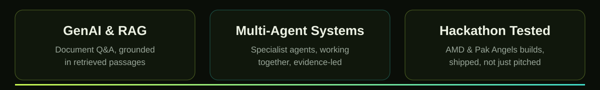
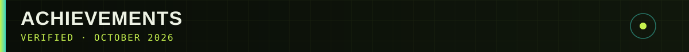
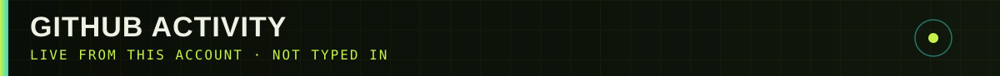

### BSCS · UET Lahore (2025–present) · Gojra, Punjab, Pakistan
### I build practical AI software — and test it in hackathons, not just in notebooks.

- 🏆 **Pak Angels GenAI & Agentic AI Cohort 11 — Top Performer** · ASPIRE Pakistan · PAGAI-TP-0240
- 🎓 **AI Fluency for Students** · Anthropic
- 🎓 **AI Fluency: Framework and Foundations** · Anthropic
- 🎓 **Claude Code in Action** · Anthropic
- 🎓 **Getting Started with Generative AI** · IBM · ID 2d11f1b1-3a71-48b1-bb6d-b9f581646f68

*All issued October 2026. Hackathons: AMD Developer AI Hackathon ACT III · Pak Angels Cohort 11 final.*

| Project | Live app |
|---|---|
| **Telltale** — Predictive Maintenance AI |  |
| **KisanOS** — Multi-Agent Farm Advisor |  |
| **Ustad Assist** — AI assistant, Pak Angels |  |
| **Code Doctor AI** — AI Code Debugger |  |
| **Studient AI** — AI Study Assistant |  |
| **LegalAI** — RAG document Q&A |  |
| **NEXUS — OSINT Intelligence Platform** — ARIA · RAVEN · VULCAN · CIPHER · ORACLE |  |
| **Octo AI** — Personal AI Voice & Chat Assistant |  |

**GenAI & RAG**

**Code & APIs**

*Contribution graph generated from my real GitHub activity — not typed in.*

*Stats cards are generated live from this account — no counts typed in here.*

**Portfolio:** https://sharjeel-portfolio-sharjeelsarwar-ai2.vercel.app/
**LinkedIn:** https://www.linkedin.com/in/sharjeel-sarwar-a18414327
**GitHub:** https://github.com/Sharjeelsarwar-ai2

